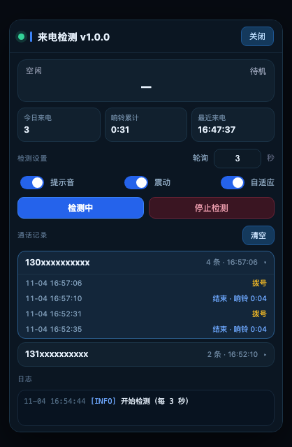
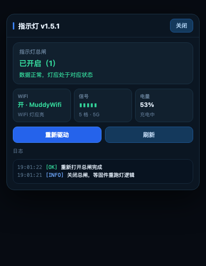

# U30 Air 插件集

UFI-TOOLS（KANO 插件容器）用的两个小插件，跑在 U30 Air 上。

**版本 1.0.0**

<br clear="left" />

---

## 插件列表

### 来电检测.js

盯住设备的通话状态，来电时给出提示，并保留通话记录。

- 检测：轮询 `dumpsys telephony.registry` / `dumpsys telecom` / `getprop` / `dumpsys audio` 四个探针，自动挑能用的那个
- 提示：入口按钮左侧指示灯变色（待机绿 / 来电黄 / 通话中红）+ 提示音 + 震动
- 记录：按号码分组，点号码展开该号码的全部「拨号 / 结束」记录
- 落盘：`/data/adb/u30air-callwatch/store.json`，关掉 App 也不丢
- 面板：默认不弹出，点开才显示

### 指示灯唤醒.js

面板三颗灯（电池 / WiFi / 信号）的诊断与修复。

- 显示指示灯总闸状态（`indicator_light_switch` 的原始值）
- 读取真实状态：WiFi（`SSID1`）、信号格数（`network_rssi`）、网络制式、电量
- 判断每颗灯「应该」是什么状态
- 「重新驱动」：把总闸写 0 再写 1，逼固件重跑一遍灯逻辑

---

## 界面预览

**来电检测**



**指示灯**



---

## 安装

1. UFI-TOOLS 登录并开启高级功能
2. 插件页面导入对应的 `.js` 文件
3. 页面底部功能区会出现入口按钮

升级时保持文件名不变，宿主才会原地覆盖，否则会当成新插件多出一条。

---

## 原理备忘

### 通话检测

Android 不给 shell 实时通话回调，只能定期 dump 系统服务：

| 探针 | 读取内容 |
|---|---|
| `telephony.registry` | `mCallState`（0 空闲 / 1 响铃 / 2 通话）、`mCallIncomingNumber` |
| `dumpsys telecom` | `mIsInCall`、`CALL_STATE_*` |
| `getprop` | `gsm.call.state` 一类属性 |
| `dumpsys audio` | `MODE_IN_CALL`，只能判断「在通话」 |

### 指示灯

面板灯由模组固件驱动，不是 AP 侧 `gpio-leds`。控制入口是原厂 web 接口：

```
GET  /goform/goform_get_cmd_process?cmd=indicator_light_switch
POST /goform/goform_set_cmd_process   goformId=INDICATOR_LIGHT_SETTING&indicator_light_switch=1
```

插件走 App 自带的反向代理 `/api/goform/*`，需要登录票据 `localStorage['kano_sms_token']`。

**限制**：固件只暴露一个总闸，没有分灯控制。`signal_led` / `power_led` / `wifi_led` / `led_state` 这些字段在固件里都不存在，具体哪颗灯亮、什么颜色，由固件内部按 `network_rssi` 和 WiFi 状态自己算。

两套信号指标不一致属正常：

| 来源 | 含义 |
|---|---|
| 模组 `network_rssi` | 0–5 格，面板灯用的就是这个 |
| Android `ssRsrp` | dBm 值（如 −99），系统侧另一套算法 |

---

## 目录

```
.
├── README.md
├── LICENSE
├── docs/
│   ├── icon.png
│   ├── icon.svg
│   ├── call-detect.png
│   └── indicator.png
├── 来电检测.js
└── 指示灯唤醒.js
```

早期还试过写 sysfs 驱动 net_* 灯：节点能写、能读回 255，但灯不亮 —— 灯根本不在那条通路上，真正的控制在模组固件里。

---

## 许可

MIT
